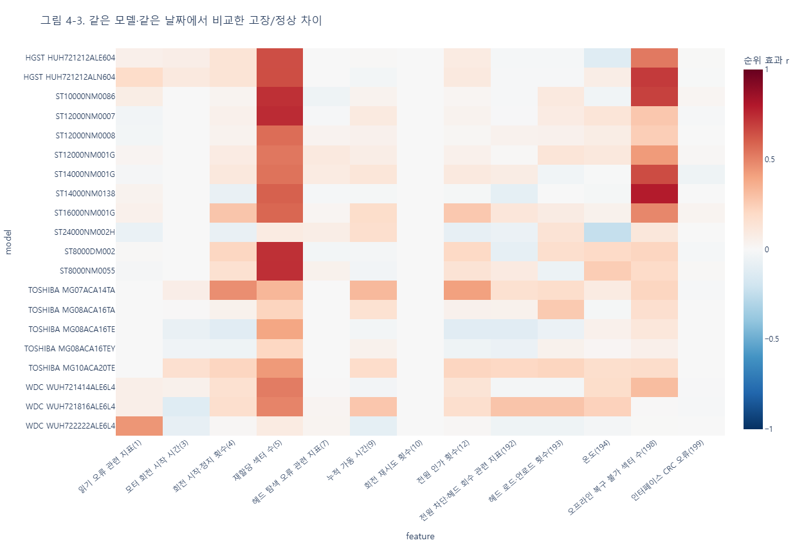
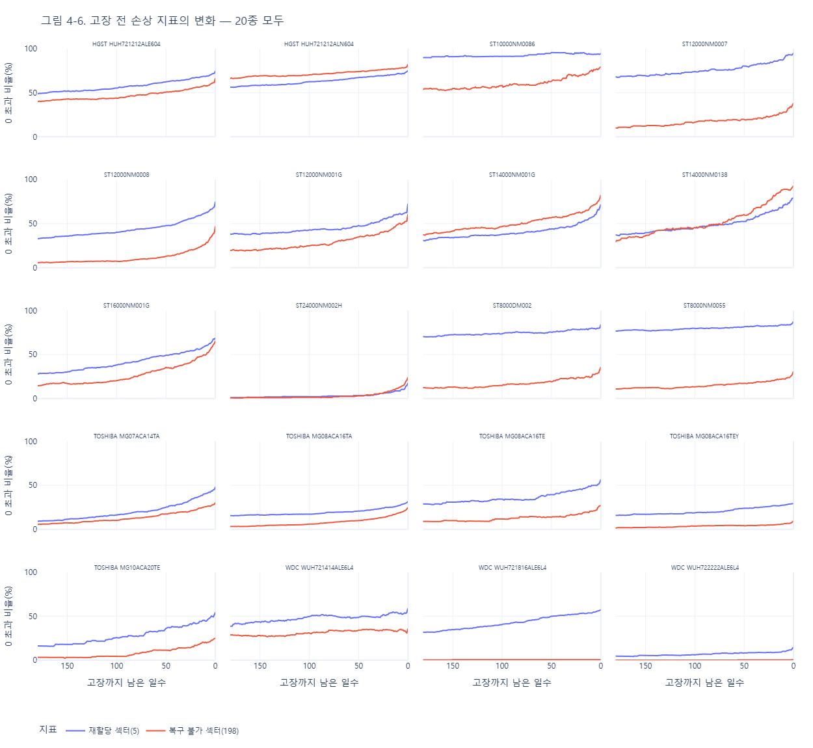
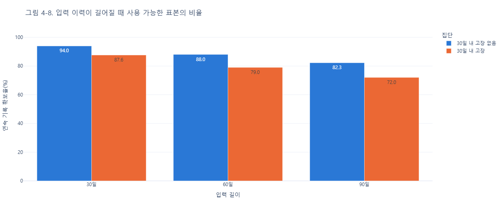
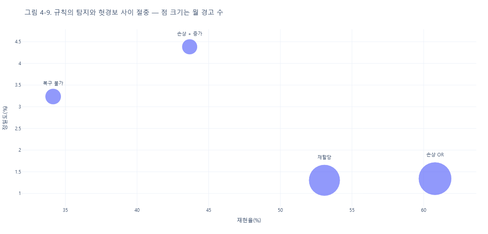

# hdd-failure-prediction

(프로젝트명 미정) 데이터센터 HDD 고장 예측·교체 지원

데이터센터 하드디스크의 SMART 기록으로 **30일 안에 고장 날 디스크**를 예측하고, 교체 대상을 웹 화면으로 알린다.
목표는 고장 후 교체보다 비용이 덜 드는 **사전 교체 정책**이다.

> 포스코K뉴딜 데이터분석 3기 최종 프로젝트

## 체험해 보기
**클릭형 프로토타입: https://madcoww.github.io/hdd-failure-prediction/**

PC와 휴대폰에서 같은 주소로 열린다. 대시보드에서 위험 디스크 선택 → 디스크 상세에서 SMART 추이 · 위험 근거 확인 → 교체 목록에서 승인 또는 보류 → '교체 예정' · '보류' 상태 확인. 예시 데이터이고, 오른쪽 위 **초기화**로 처음부터 다시 할 수 있다. 소스는 [`prototype/`](prototype/).

## 데이터
- **도메인 정리(초안)**: [HDD 고장·SMART 지표·수집 주기·전문가 질문 답변](data/도메인.md)
- **출처**: [Backblaze Drive Stats](https://www.backblaze.com/cloud-storage/resources/hard-drive-test-data). 실제 데이터센터에서 측정한 일별 SMART 기록
- **기간**: 2024 Q2 ~ 2026 Q2 (821일)
- **EDA v3 범위 (최신)**: 고장 수 상위 20종 중 Seagate 10종, SMART raw 20개. 디스크 115,901개로 전체 HDD의 **29.95%**, 고장 디스크 4,066개로 전체 고장의 **38.66%**를 포함한다. [EDA v3](eda/eda_v2_30%25.ipynb), [범위 집계](data/backblaze/summary/eda_v3_scope.csv). 파일명의 30%는 HDD 디스크 수 비중을 반올림한 값이다.
- **EDA v2 범위**: 고장 수 상위 HDD 20종, 디스크 338,083개, 고장 9,920개. 전체 디스크의 87.4%, 고장의 94.3%
  - SMART 열: 20종 모두 기록하는 공통 raw 13개 (1, 3, 4, 5, 7, 9, 10, 12, 192, 193, 194, 198, 199)
- **EDA v1 범위**: Seagate `ST12000NM0008` 1종. 디스크 19,516개, 고장 1,117건. [EDA v1](eda/eda_v1_5%25.ipynb): SSD 제외 후 분석 목적 → 데이터 개요 → 품질 → 기록 간격·관측 기간 → 고장 현황 → 고장 전 변화 → 변수 관계 → 결론(초안). pandas로 분석하고 matplotlib·seaborn으로 시각화한다. 각 절은 질문·표/그림·관찰 결과·후속 조치 순서다. 그림은 `eda/figures/eda_v1/`에 저장한다. 파일명의 5%는 전체 HDD 디스크 수 대비 비중이며 샘플링 비율이 아니다.
- 첫 모델링: `ST12000NM0008` 1종으로 4개 머신러닝 모델 비교. [실험 계획](ml/v1/README.md)
- 원본은 용량이 커서 저장소에 올리지 않았다. 내려받는 방법은 [재현 방법](#재현-방법)을 본다

## EDA 주요 결과 (v2)
보고서: [`eda/eda_v3_87%.ipynb`](eda/eda_v3_87%25.ipynb). 월별 기준일마다 "30일 안에 고장" 여부를 붙이고, 같은 모델·같은 날짜의 정상 디스크와 비교했다.

- 고장을 가장 잘 구분하는 지표는 **재할당 섹터(5)**, 그다음이 **오프라인 복구 불가 섹터(198)**. 모델별 효과 크기 중앙값은 각각 0.54, 0.23
- 고장 디스크의 **29.9%는 손상 지표(5, 198)가 끝까지 0**이었다. 규칙만으로는 놓치는 고장이 있다
- 규칙 기준선 "손상 신호 + 최근 30일 증가": 재현율 43.7%, 정밀도 4.4%, 월평균 경고 3,284개
- 고장 예정 디스크의 이력 확보율: 연속 30일 87.6%, 90일 72.0%
- 회전 재시도(10)는 20종 중 19종에서 값이 변하지 않았다

GitHub에서는 노트북의 Plotly 그림이 보이지 않아 PNG로 함께 올렸다. 전체 그림은 [`eda/figures/eda_v2/`](eda/figures/eda_v2/)에 있다.

| 모델별 지표 효과 크기 (4-3) | 고장 전 손상 지표 추이 (4-6) |
|---|---|
|  |  |
| **입력 이력 확보율 (4-8)** | **규칙 기준선 경고 수 vs 재현율 (4-9)** |
|  |  |

## 폴더 구조

### 한눈에 보기
| 폴더 | 역할 | 저장소 |
|---|---|---|
| `data/` | 데이터와 데이터 설명 | 설명·집계표만 |
| `eda/` | 탐색적 분석: 추출·분석 스크립트, 보고서, 그림 | 중간 결과(`analysis/`) 제외 |
| `ml/v1/` | ST12000NM0008 전처리·4개 모델 학습·평가 | 실행 결과(`artifacts/`) 제외 |
| `docs/` | 기획 산출물: 기능정의서, Journey Map, 화면설계서, WBS | 팀 작성본만 |
| `mockups/` | 웹 화면 시안 v1~v4, 모바일 시안 | O |
| `prototype/` | 클릭형 프로토타입 (GitHub Pages로 공개) | O |
| `practice/` | 초기 실험 노트북 | X |
| `tools/` | 로컬 실행 도구 (DuckDB) | X |

### 전체 구조
```
hdd-failure-prediction/
├─ README.md                      이 문서
├─ .gitignore                     저장소 제외 목록
├─ LICENSE                        MIT (코드 대상. 데이터는 Backblaze 이용 조건을 따름)
│
├─ data/backblaze/                ── 데이터
│   ├─ README.md                  데이터 설명: 열 의미, 주의점, 도메인 기초, 디스크 가격
│   ├─ merged/ *                  ST12000NM0008 전체 기간 통합본 (v1용, Parquet 약 1.2GB)
│   ├─ fleet_slim/ *              분기별 전 모델 경량 데이터 (scripts/01 결과, 약 1GB)
│   ├─ summary/                   집계표
│   │   ├─ model_rank.csv         모델별 디스크 수·고장 수·AFR 순위 (scripts/02 결과)
│   │   ├─ smart_coverage_top5.csv  상위 5개 모델의 SMART 열 기록률 (scripts/04 결과)
│   │   ├─ top20_models.csv       v2 대상 20종 (scripts/09 결과)
│   │   └─ common13_columns.json  v2 공통 SMART 열 13개
│   ├─ top20_common13/ *          v2 일별 추출 데이터 (scripts/09 결과, 약 3.6GB)
│   └─ raw/ *                     원본 압축 해제 위치 (원본 zip은 따로 보관)
│
├─ eda/                           ── 탐색적 분석
│   ├─ eda_v2_30%.ipynb            EDA v3 보고서 (최신, Seagate 10종 · SMART 20개)
│   ├─ eda_v3_87%.ipynb               EDA v2 보고서 (상위 20종 · 공통 SMART 13개)
│   ├─ eda_v1_5%.ipynb                  EDA v1 보고서 (ST12000NM0008 1종)
│   ├─ scripts/                   번호 순서대로 실행
│   │   ├─ 01_fleet_slim.py       전 모델(97종)에서 가벼운 열만 분기별로 추출
│   │   ├─ 02_model_rank.sql      모델별 디스크 수·고장 수·AFR 집계
│   │   ├─ 03_extract_model.py    모델 1종의 전체 SMART 열 추출 (v1)
│   │   ├─ 04_smart_coverage.py   고장 수 상위 5개 모델의 SMART 열 기록률 비교 (v1)
│   │   ├─ 05~06                  표본 날짜로 모델 간 공통 SMART 열 확인
│   │   ├─ 07~08                  821일 전체로 SMART 열 기록 여부 확인
│   │   ├─ 09_extract_top20_common13.py  상위 20종 · 공통 13개 열 실제 값 추출
│   │   ├─ 10_analyze_top20_common13.py  품질 · 월별 표본 · 매칭 비교 · 추이 · 규칙 기준선
│   │   ├─ 11~12                  EDA v2 노트북 생성 · 해석 추가
│   │   └─ archive/               노트북 생성 보조 스크립트 (이전 단계)
│   ├─ analysis/ *                스크립트 중간 결과 (약 4GB)
│   └─ figures/                   보고서 그림 PNG (파일명 번호 = 보고서 절 번호)
│       ├─ eda_v2/                v2 그림 12장
│       └─ eda_v1/                v1 그림 15장
│
├─ ml/v1/                         ── 첫 머신러닝 비교 실험
│   ├─ README.md                  입력·라벨·분할·평가 계획
│   ├─ ml_v1.ipynb                첫 셀에서 수치 변경·재학습·재평가
│   ├─ notebook_runner.py         설정 확인·경보 비율별 비교
│   ├─ train.py                   로지스틱 회귀·RF·XGBoost·LightGBM 비교
│   ├─ test_training.py           시간 처리·경보 예산 검증
│   ├─ requirements.txt           실행 패키지
│   └─ artifacts/ *               학습 데이터·모델·실제 평가 결과
│
├─ docs/                          ── 기획 산출물
│   ├─ v1/                        팀 작성본
│   │   ├─ 1_메뉴구조_기능정의서_v1.xlsx
│   │   ├─ 2_Journey_Map_v1.pptx
│   │   ├─ 3_서비스구조도_화면설계서_v1.pptx
│   │   ├─ 4_WBS_v1.xlsx
│   │   ├─ 5_화면설계서_웹SB_v1.pptx
│   │   └─ 5_화면설계서_모바일SB_v1.pptx
│   ├─ 양식/ *                    수업 제공 양식 4종 + 화면설계서 예시
│   ├─ journey_map/               Journey Map 이미지
│   ├─ notion_cover/              노션 표지 이미지
│   └─ qr_prototype.png           프로토타입 주소 QR
│
├─ mockups/                       ── 화면 시안 (v4가 최신)
│   ├─ v1/                        첫 시안 4장
│   ├─ v2/, v3/                   화면 5개 시안 (HTML + PNG, make_screens.py로 생성)
│   ├─ v4/                        최신 웹 시안
│   │   ├─ 0_flow*, 0_flowchart   서비스 이용 흐름도·순서도
│   │   ├─ 1_dashboard            대시보드 (요약 카드, 데이터센터 평면도, Vault 앞면)
│   │   ├─ 2_pod_topview          Pod 탑뷰 (디스크 60개 배치, 선택 디스크 위치)
│   │   ├─ 3_disk_detail          디스크 상세 (30일 위험, 잔여수명, SMART 기록)
│   │   ├─ 4_replace_list         교체 목록 (승인·보류, 처리 이력)
│   │   ├─ 5_model_compare        모델 비교 (방식별 성능·절감액)
│   │   └─ 6_alarm_settings       알림 설정 팝업
│   └─ mobile/                    모바일 시안 6장 (푸시, 홈, 디스크 상세, 교체 목록, 보류, 알림 설정)
│
├─ prototype/                     ── 클릭형 프로토타입 (gh-pages 브랜치로 배포)
│   ├─ index.html                 시작 화면 (PC · 모바일 같은 주소)
│   ├─ css/ · js/ · assets/       스타일, 예시 데이터와 화면 동작, 아이콘
│   └─ README.md                  체험 흐름 · 실행 방법
│
├─ practice/ *                    초기 실험 노트북
└─ tools/duckdb/ *                DuckDB 실행 파일 (pip install duckdb 로 대체 가능)
```
`*` 표시는 용량·저작권·개인 자료라서 저장소에 올리지 않는다.

## 재현 방법
1. Backblaze 사이트에서 2024 Q2 ~ 2026 Q2 분기 zip 9개를 내려받는다
2. 환경변수 `HDD_RAW_DIR`에 zip을 둔 폴더를 지정한다 (예: `export HDD_RAW_DIR=D:/backblaze`)
3. 패키지를 설치한다
   ```bash
   pip install duckdb pyarrow pandas numpy scipy plotly kaleido nbformat ipython
   ```
4. **EDA v2**: 모델 순위를 만든 뒤 상위 20종을 추출·분석한다
   ```bash
   python eda/scripts/01_fleet_slim.py
   cd eda && duckdb -c ".read scripts/02_model_rank.sql" && cd ..
   python eda/scripts/09_extract_top20_common13.py
   python eda/scripts/10_analyze_top20_common13.py
   ```
   그다음 `eda/eda_v3_87%.ipynb`를 실행한다
5. **EDA v1**: `python eda/scripts/03_extract_model.py ST12000NM0008` 후 `eda/eda_v1_5%.ipynb`를 실행한다

## 진행 상황
- [x] 주제·데이터 선정
- [x] EDA v1 (1종), EDA v2 (상위 20종)
- [x] 기획 산출물: 기능정의서, Journey Map, 화면설계서(웹·모바일), WBS
- [x] 클릭형 프로토타입 (예시 데이터)
- [x] 첫 모델링 대상: ST12000NM0008 1종. 다른 제품 확대는 후속 단계
- [x] 모델링 v1: ST12000NM0008에서 규칙 기준선과 머신러닝 4개 비교 ([첫 결과](ml/v1/RESULTS.md)). 튜닝·확대·교체 시뮬레이션은 후속 단계
- [ ] 웹 알림 화면

## 라이선스
코드는 [MIT](LICENSE). 데이터는 아래 Backblaze 이용 조건을 따른다.

## 출처 표기
이 저장소의 데이터 출처는 **Backblaze**다: [Backblaze Drive Stats](https://www.backblaze.com/cloud-storage/resources/hard-drive-test-data)

Backblaze가 밝힌 이용 조건을 따른다.
1. 데이터를 쓰면 출처를 Backblaze로 밝힌다
2. 데이터 사용에 대한 책임은 사용자에게 있다
3. 데이터를 바탕으로 만든 결과물은 팔 수 있다
4. 데이터 자체는 팔 수 없다(무료)
