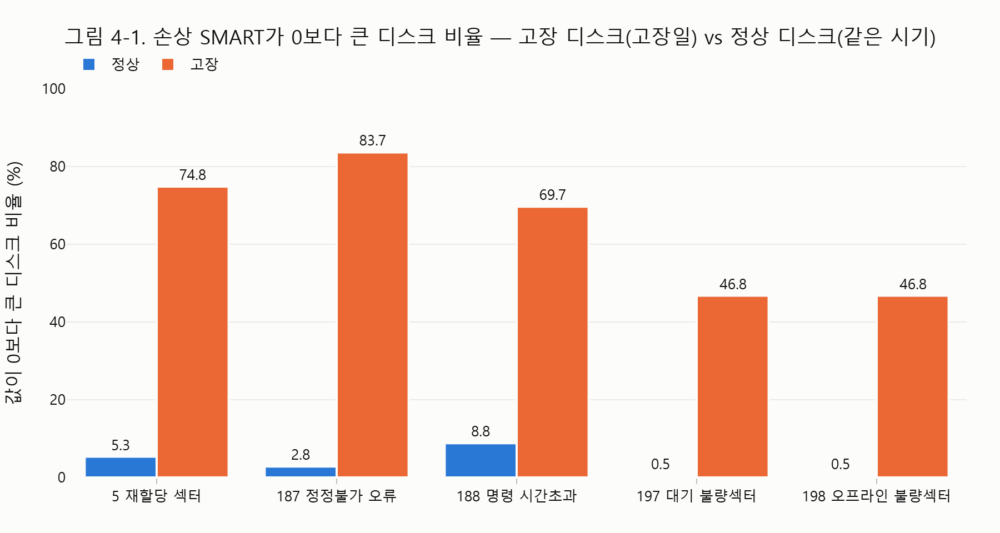
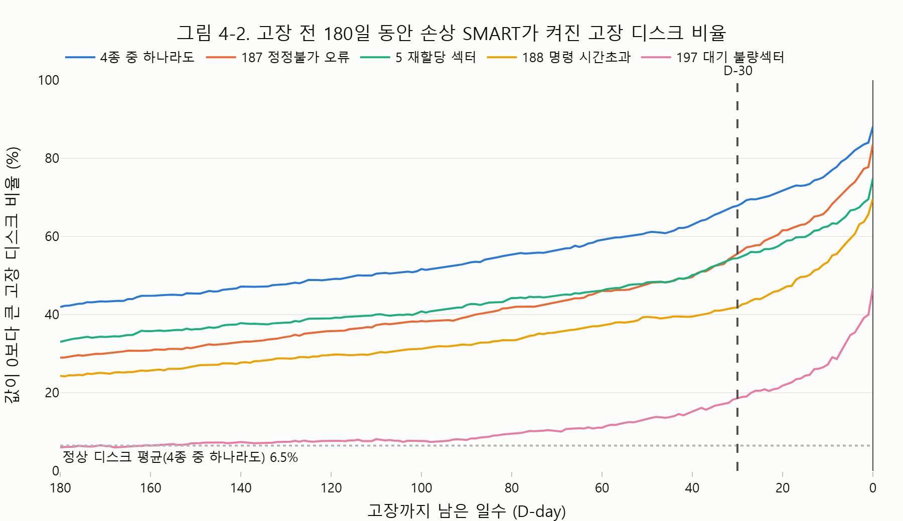
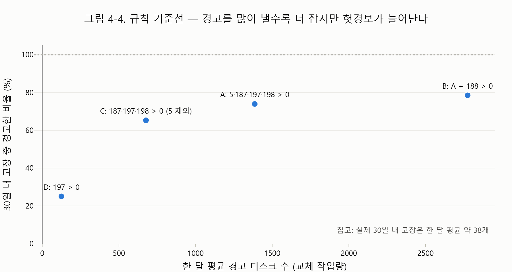
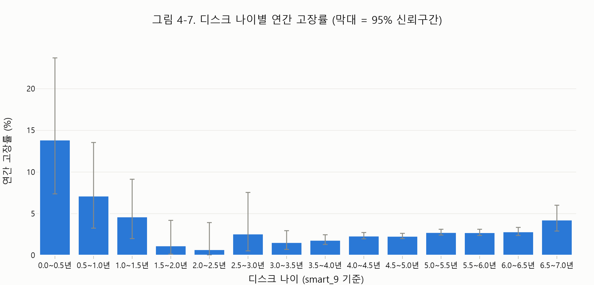

# hdd-failure-prediction

(프로젝트명 미정) 데이터센터 HDD 고장 예측·교체 지원

데이터센터 하드디스크의 SMART 기록으로 **30일 안에 고장 날 디스크**를 예측하고, 교체 대상을 웹 화면으로 알린다.
목표는 고장 후 교체보다 비용이 덜 드는 **사전 교체 정책**이다.

> 포스코K뉴딜 데이터분석 3기 최종 프로젝트

## 데이터
- **출처**: [Backblaze Drive Stats](https://www.backblaze.com/cloud-storage/resources/hard-drive-test-data). 실제 데이터센터에서 측정한 일별 SMART 기록
- **범위**: 2024 Q2 ~ 2026 Q2 (821일)
- **대상 모델**: Seagate `ST12000NM0008`. 디스크 19,516개, 고장 1,117건
- 원본은 용량이 커서 저장소에 올리지 않았다. 내려받는 방법은 [재현 방법](#재현-방법)을 본다

## EDA 주요 그림
GitHub에서는 노트북의 Plotly 그림이 보이지 않아 PNG로 함께 올렸다. 전체 15장은 [`eda/figures/`](eda/figures/)에 있다.

| 손상 SMART: 고장 vs 정상 (4-1) | 고장 전 손상 지표 추이 (4-2) |
|---|---|
|  |  |
| **규칙 기준선 성능 (4-4)** | **나이별 고장률 (4-7)** |
|  |  |

## 폴더 구조

### 한눈에 보기
| 폴더 | 역할 | 저장소 |
|---|---|---|
| `data/` | 데이터와 데이터 설명 | 설명·집계표만 |
| `eda/` | 탐색적 분석: 추출 스크립트, 보고서, 그림 (데이터는 `data/`에 저장) | O |
| `docs/` | 기획 산출물: 기능정의서, Journey Map, 화면설계서 | 팀 작성본만 |
| `mockups/` | 웹 화면 시안 v1~v4 | O |
| `practice/` | 초기 실험 노트북 | X |
| `tools/` | 로컬 실행 도구 (DuckDB) | X |

### 전체 구조
```
hdd-failure-prediction/
├─ README.md                      이 문서
├─ .gitignore                     저장소 제외 목록
├─ LICENSE                        MIT (코드 대상. 데이터는 Backblaze 이용 조건을 따름)
│
├─ data/backblaze/                ── 데이터
│   ├─ README.md                  데이터 설명: 열 의미, 주의점, 도메인 기초, 디스크 가격
│   ├─ merged/ *                  대상 모델 전체 기간 통합본 (Parquet 약 1.2GB)
│   ├─ fleet_slim/ *              분기별 전 모델 경량 데이터 (scripts/01 결과, 약 1GB)
│   ├─ summary/                   집계표
│   │   ├─ model_rank.csv         모델별 디스크 수·고장 수·AFR 순위 (scripts/02 결과)
│   │   └─ smart_coverage_top5.csv  상위 5개 모델의 SMART 열 기록률 (scripts/04 결과)
│   └─ raw/ *                     원본 압축 해제 위치 (원본 zip은 따로 보관)
│
├─ eda/                           ── 탐색적 분석
│   ├─ eda.ipynb                  EDA 보고서 (분석 목적 → 데이터셋 → 전처리 → 시각화 → 인사이트)
│   ├─ scripts/                   원본 zip → data/backblaze/ 에 결과 저장 (번호 순서대로 실행)
│   │   ├─ 01_fleet_slim.py       전 모델(97종)에서 가벼운 열만 분기별로 추출
│   │   ├─ 02_model_rank.sql      모델별 디스크 수·고장 수·AFR 집계 → 대상 모델 선정
│   │   ├─ 03_extract_model.py    선정한 모델 1종의 전체 SMART 열 추출
│   │   └─ 04_smart_coverage.py   고장 수 상위 5개 모델의 SMART 열 기록률 비교
│   └─ figures/                   보고서 그림 PNG 15개 (파일명 번호 = 보고서 절 번호)
│
├─ docs/                          ── 기획 산출물
│   ├─ v1/                        팀 작성본
│   │   ├─ 1_메뉴구조_기능정의서_v1.xlsx
│   │   ├─ 2_Journey_Map_v1.pptx
│   │   └─ 3_서비스구조도_화면설계서_v1.pptx
│   ├─ 양식/ *                    수업 제공 양식 4종 + 화면설계서 예시
│   └─ notion_cover_8bit.png      표지 이미지
│
├─ mockups/                       ── 웹 화면 시안 (v4가 최신)
│   ├─ v1/                        첫 시안 4장
│   ├─ v2/, v3/                   화면 5개 시안 (HTML + PNG, make_screens.py로 생성)
│   └─ v4/                        최신 시안
│       ├─ 0_flow*, 0_flowchart   서비스 이용 흐름도·순서도
│       ├─ 1_dashboard            대시보드 (요약 카드, 데이터센터 평면도, Vault 앞면)
│       ├─ 2_pod_topview          Pod 탑뷰 (디스크 60개 배치, 선택 디스크 위치)
│       ├─ 3_disk_detail          디스크 상세 (30일 위험, 잔여수명, SMART 기록)
│       ├─ 4_replace_list         교체 목록 (승인·보류, 처리 이력)
│       ├─ 5_model_compare        모델 비교 (방식별 성능·절감액)
│       └─ journey_map*.png       Journey Map 이미지
│
├─ practice/ *                    초기 실험 노트북
└─ tools/duckdb/ *                DuckDB 실행 파일 (pip install duckdb 로 대체 가능)
```
`*` 표시는 용량·저작권·개인 자료라서 저장소에 올리지 않는다.

## 재현 방법
1. Backblaze 사이트에서 2024 Q2 ~ 2026 Q2 분기 zip 9개를 내려받는다
2. `eda/scripts/` 안 스크립트의 `RAW` 경로를 zip을 둔 폴더로 바꾼다
3. 스크립트를 순서대로 실행한다
   ```bash
   pip install duckdb pyarrow pandas plotly kaleido scipy
   python eda/scripts/01_fleet_slim.py
   python eda/scripts/03_extract_model.py ST12000NM0008
   ```
4. `eda/eda.ipynb`를 실행한다

## 진행 상황
- [x] 주제·데이터 선정, EDA
- [ ] 모델링: 규칙 기준선 → 로지스틱 회귀 → LightGBM → GRU. 절감 금액으로 비교
- [ ] 웹 알림 화면

## 라이선스
코드는 [MIT](LICENSE). 데이터는 아래 Backblaze 이용 조건을 따른다.

## 출처 표기
이 저장소의 데이터 출처는 **Backblaze**다: [Backblaze Drive Stats](https://www.backblaze.com/cloud-storage/resources/hard-drive-test-data)

Backblaze가 밝힌 이용 조건을 따른다.
1. 데이터를 쓰면 출처를 Backblaze로 밝힌다
2. 데이터 사용에 대한 책임은 사용자에게 있다
3. 데이터를 바탕으로 만든 결과물은 팔 수 있다
4. 데이터 자체는 팔 수 없다(무료)
